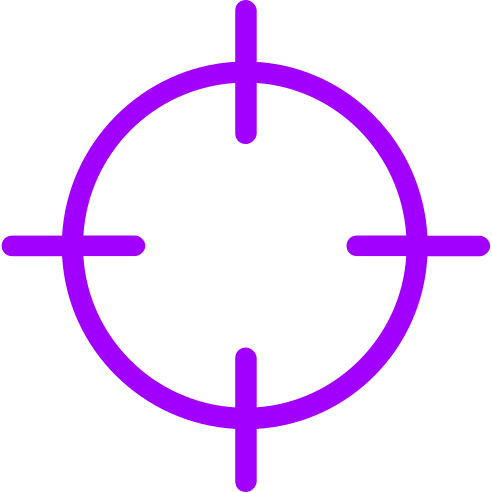

<p align="center">
  <picture>
    <source media="(prefers-color-scheme: dark)" srcset="assets/accenture-logo-white.svg">
    
  </picture>
</p>

<h1 align="center"></h1>

<p align="center">
  <picture>
    <source media="(prefers-color-scheme: dark)" srcset="assets/apex-tagline-dark.svg">
    
  </picture>
</p>

---

This repository hosts the threat intelligence reports that Accenture Security APEX Labs publishes from Accenture Cyber Intelligence (CI) research into active threats. Each report gives defenders what they need to detect and respond to the threat: indicators of compromise (IOCs), detection rules, network fingerprints and mitigation guidance.

The reports are published as web pages at **[accenture.github.io/cyber-intelligence](https://accenture.github.io/cyber-intelligence/)**. All content is **TLP:CLEAR** and free to use in your defensive stack.


## What reports include

<table>
  <tr>
    <td align="center" width="20%"><br><b>Threat analysis</b><br><sub>Technical findings on malware and attacker tooling</sub></td>
    <td align="center" width="20%"><br><b>Indicators</b><br><sub>Hashes of known malicious samples</sub></td>
    <td align="center" width="20%"><br><b>Detection rules</b><br><sub>YARA rules for files and memory on Windows and Linux</sub></td>
    <td align="center" width="20%"><br><b>Network fingerprints</b><br><sub>JA4 and JA3 TLS fingerprints and protocol indicators</sub></td>
    <td align="center" width="20%"><br><b>Mitigation</b><br><sub>Practical guidance for detection and response</sub></td>
  </tr>
</table>

## Contents

- [Published reports](#published-reports)
- [Using this intelligence](#using-this-intelligence)
- [Traffic Light Protocol](#traffic-light-protocol)
- [Feedback](#feedback)
- [Disclaimer](#disclaimer)
- [About](#about)

## Published reports

| Report | Published | Platform |
| --- | --- | --- |
| [**Settra Blinder**](https://accenture.github.io/cyber-intelligence/settra-blinder/)<br>64-bit Windows EDR evasion toolkit that abuses vulnerable kernel drivers (BYOVD) to blind endpoint defences | July 2026 | Windows x64 |
| [**RustyRocket**](https://accenture.github.io/cyber-intelligence/rustyrocket/)<br>Implant family covering Windows and Linux agents, proxies and the RocketLaunch service installer | March 2026 | Windows, Linux |

## Using this intelligence



**Indicators.** Add the sample hashes to EDR blocklists and SIEM watchlists, and search historical endpoint telemetry for earlier executions.

**YARA rules.** Copy a rule from its report page, save it as a `.yar` file and run it with the [YARA](https://virustotal.github.io/yara/) command-line tool. You can also load it into any EDR, sandbox or file-scanning pipeline that accepts YARA rules.

```bash
# Scan a directory recursively and print the matching strings
yara -r -s rule.yar /path/to/scan

# Scan the memory of a running process (usually needs administrator or root rights)
yara -s rule.yar <PID>
```

Some rules import YARA modules such as `pe` or `elf`, which are included in standard YARA builds.

**Network fingerprints.** Alert on the JA4 and JA3 fingerprints in your NDR or SIEM pipeline, and prefer JA4 where your tooling supports it. Other software built on the same TLS library can share a fingerprint, so check destination, SNI and host context before blocking.

**Mitigation guidance.** Each report ends with recommendations specific to the threat. Use them to prioritise hardening and monitoring work.

**Test before you block.** Run new rules in alert-only mode first to measure false positives in your environment.

## Traffic Light Protocol


All content in this repository is marked **TLP:CLEAR** under [FIRST TLP 2.0](https://www.first.org/tlp/). Recipients may share it without restriction, subject to standard copyright rules.

You are welcome to load the indicators and rules into your own tools and to redistribute them. Please credit Accenture Security APEX Labs. Keep the rule metadata (author, date, version) intact so others can trace updates.

## Feedback


If a rule produces false positives, misses a sample it should catch, or a report contains an error, please [open an issue](https://github.com/Accenture/cyber-intelligence/issues). Include the report and rule name, the rule version, your YARA version, and the SHA-256 of any file involved.

Do not attach malware samples to issues, and do not post client, personal or other sensitive data.

## Disclaimer

This intelligence is provided as is, without warranty of any kind, to support network defence. Indicators age, and detections can produce false positives. Validate everything in your own environment before taking blocking or response action.

## About


Accenture Security APEX Labs (Adversary Pursuit, Engagement, and Exploitation) publishes the reports in this repository. They share indicators, detection rules and mitigation guidance from Accenture Cyber Intelligence research with the wider defender community.

Accenture Cyber Intelligence (CI) provides advanced threat intelligence, adversary research and detection capabilities to help organisations stay ahead of emerging threats.

For more about Accenture's security services, visit [Accenture Cybersecurity](https://www.accenture.com/us-en/services/cybersecurity).
